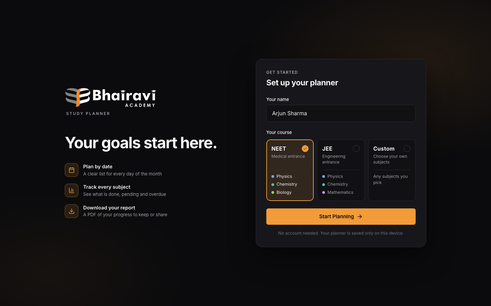
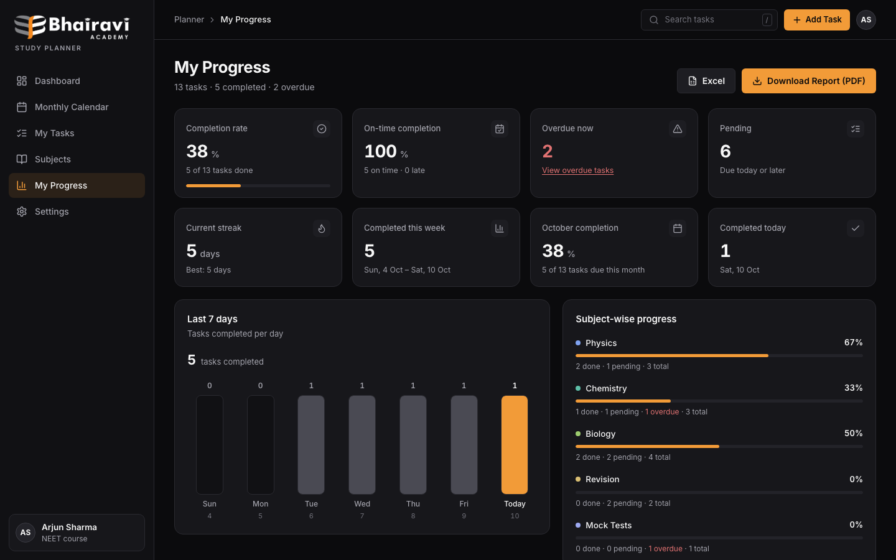
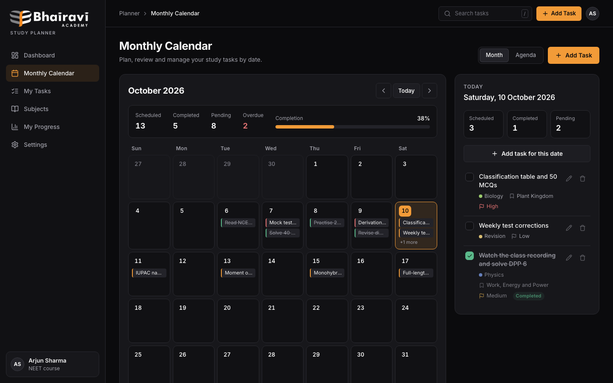
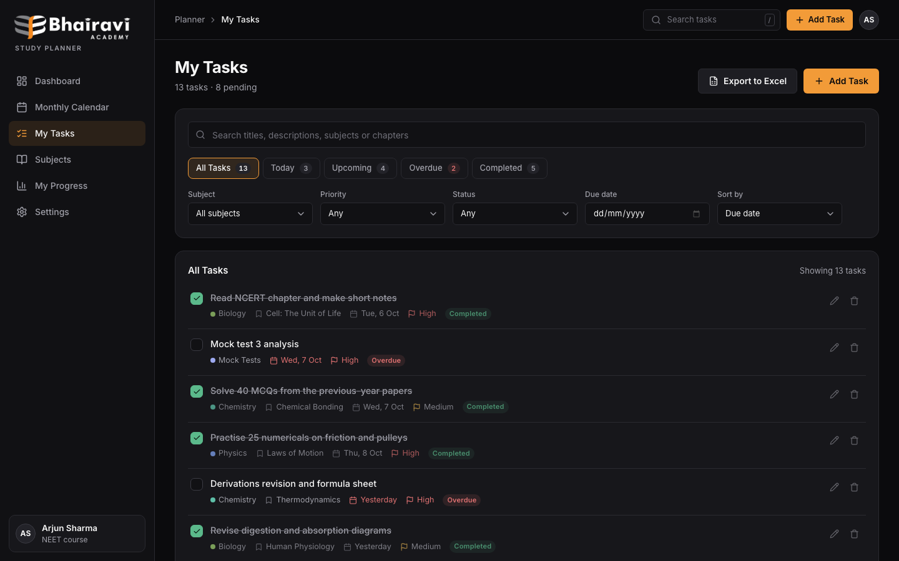
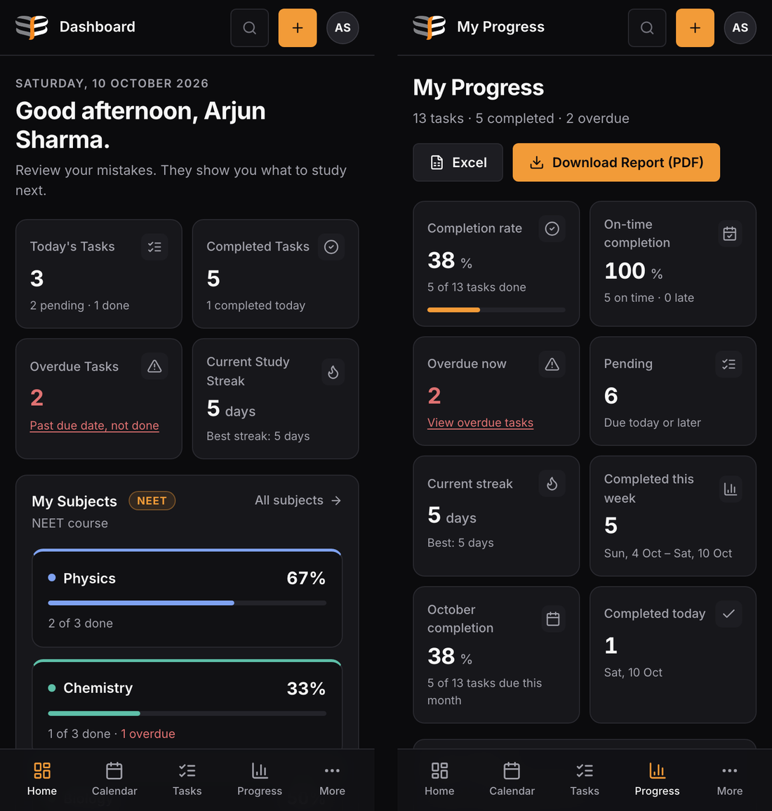
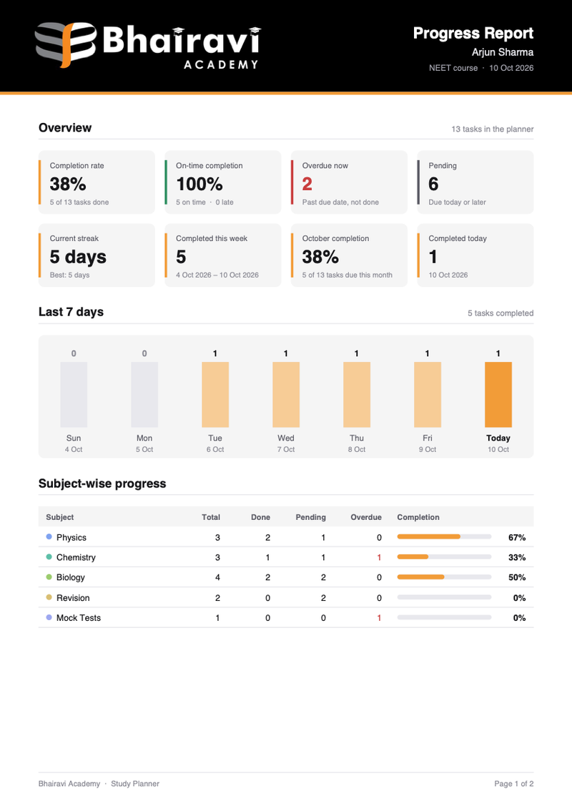

## Features

**Set up in seconds**
- Enter your name and choose your course: **NEET** (Physics, Chemistry, Biology), **JEE** (Physics, Chemistry, Mathematics) or **Custom** (pick your own subjects).
- No sign-up, no password. Your planner is ready immediately.

**Plan your study**
- Add tasks with a title, subject, chapter, due date and priority.
- **Monthly calendar** with a day panel and an agenda view.
- **My Tasks** with instant search, filters (subject, priority, status, date) and Today / Upcoming / Overdue / Completed views.
- Tasks that are not finished by the end of their due date move to **Overdue** automatically.

**Track your progress**
- **Dashboard:** today's plan, overdue alerts, study streak, upcoming deadlines and a tile for each subject in your course.
- **My Progress:** completion rate, on-time rate, streaks, weekly activity chart, and breakdowns by subject and priority.
- **Subjects:** each subject's tasks grouped by chapter.

**Take your results with you**
- **Progress report (PDF)** with the Academy logo, all statistics, overdue tasks and recent completions.
- **Excel export** (.xlsx) with Summary, All Tasks, Overdue, Pending and Completed sheets.
- **Backup file** to move your planner to another device.

**Works everywhere**
- Desktop, tablet and phone layouts. Add it to your phone's home screen like an app.
- Keyboard shortcuts: <kbd>/</kbd> to search, <kbd>N</kbd> to add a task.

## Screenshots

| Welcome | My Progress |
| --- | --- |
|  |  |
| **Monthly Calendar** | **My Tasks** |
|  |  |

| Mobile | PDF progress report |
| --- | --- |
|  |  |

## How progress is calculated

Every number comes from the student's own tasks. Nothing is estimated or made up, and the PDF report uses exactly the same figures as the My Progress page.

| Statistic | How it is worked out |
| --- | --- |
| **Overdue** | Not completed, and its due date has passed. A task is due until the end of its day. |
| **Pending** | Not completed, due today or later. |
| **Completion rate** | Completed tasks ÷ all tasks. |
| **On-time rate** | Tasks completed on or before their due date ÷ completed tasks. |
| **Month completion** | Of the tasks due this month, the share that is completed. |
| **Completed today / this week** | Counted by the day a task was ticked, not the day it was due. |
| **Study streak** | Consecutive days with at least one completed task. Yesterday's streak still counts until today ends. |
| **Subject / priority %** | Completion rate within that subject or priority. |

Unticking a task removes it from the completion history. Deleting a completed task keeps it in the history, because the work was done.

## Privacy

- All data stays **in the student's own browser, on their own device**. There is no server, database, account or analytics.
- Nobody else — including the Academy — can see a student's tasks unless the student shares a report or file.
- Clearing browser data deletes the planner. Use **Settings → Backup file** to keep a copy or move to another device.
- The only outside request is the Inter font from Google Fonts. Without it, the app uses the system font and works normally.

## Getting started

The app is plain HTML, CSS and JavaScript with no dependencies and no build step. Because it uses JavaScript modules, it must be opened through a local web server; double-clicking `index.html` shows a blank page.

```bash
# from the project folder
python3 -m http.server 5500
# or
npx serve .
```

Then open **http://localhost:5500** (or the address `npx serve` prints). The VS Code **Live Server** extension also works.

## Deploying

Any static host works. There are no build settings and no server rewrites (routes use `#/…`).

**Vercel**
1. Push this repository to GitHub.
2. In Vercel, choose **Add New → Project** and import the repository.
3. Set **Framework Preset** to **Other**, leave **Build Command** empty, and set **Output Directory** to `.`
4. Deploy. Every push to `main` redeploys automatically.

**Netlify:** drag the project folder onto the Netlify dashboard.
**GitHub Pages:** *Settings → Pages →* deploy from the `main` branch, root folder.

## Project structure

```
├── index.html          App shell, welcome screen, task and confirm dialogs
├── css/
│   ├── style.css       Design tokens and components
│   └── responsive.css  Tablet, mobile and small-phone layouts
├── js/
│   ├── app.js          Start-up, routing, re-rendering on data changes
│   ├── welcome.js      First-run setup (name and course)
│   ├── state.js        In-memory store and every data change
│   ├── storage.js      Saving to localStorage, validation, backup files
│   ├── stats.js        All calculations (overdue, streaks, subject and progress stats)
│   ├── dashboard.js    calendar.js  tasks.js  subjects.js  progress.js  settings.js   (pages)
│   ├── modal.js        Add / edit task dialog
│   ├── report.js       PDF report, generated in the browser
│   ├── excel.js        Excel (.xlsx) export, generated in the browser
│   ├── navigation.js   Router, sidebar and mobile navigation
│   ├── ui.js           Toasts, dialogs and shared HTML pieces
│   ├── icons.js        Inline SVG icons (Lucide)
│   └── utils.js        Date and formatting helpers
├── assets/             Logos, favicon and home-screen icon
└── docs/screenshots/   Images used in this README
```

**For developers**
- Each page module exports `mountX(root, route)` and returns `{ update() }`. Pages read from `state` and change data only through `state.js`.
- `storage.js` is the only file that touches `localStorage`, so it is the one place to change to add a backend later.
- The PDF and Excel files are built from scratch in `report.js` and `excel.js`, so the app works offline with no libraries.
- Dates are stored as local `YYYY-MM-DD` strings and never converted through UTC, so tasks never shift a day in Indian time.

## Limitations

- Data is stored per browser and per device; there is no sync between devices (use the backup file).
- The name is a label, not a login. Anyone using the same browser sees the same planner.
- The PDF report uses standard PDF fonts, which cover Latin letters only. Text in other scripts (for example Hindi) shows as "?" in the PDF but displays normally in the app and in Excel.

## Contributing

Issues and pull requests are welcome. Before opening a pull request, please check:

1. The welcome screen requires a name and a course, and Custom requires at least one subject.
2. Adding, editing, completing, reopening and deleting a task updates the dashboard, calendar, subjects and progress pages.
3. A task due yesterday and not completed appears in **Overdue**.
4. The PDF report and Excel file download and match the My Progress page.
5. At about 390 px wide, nothing scrolls sideways and the bottom navigation works.
6. The browser console shows no errors.

---

<p align="center">Made for the students of <strong>Bhairavi Academy</strong>.</p>
